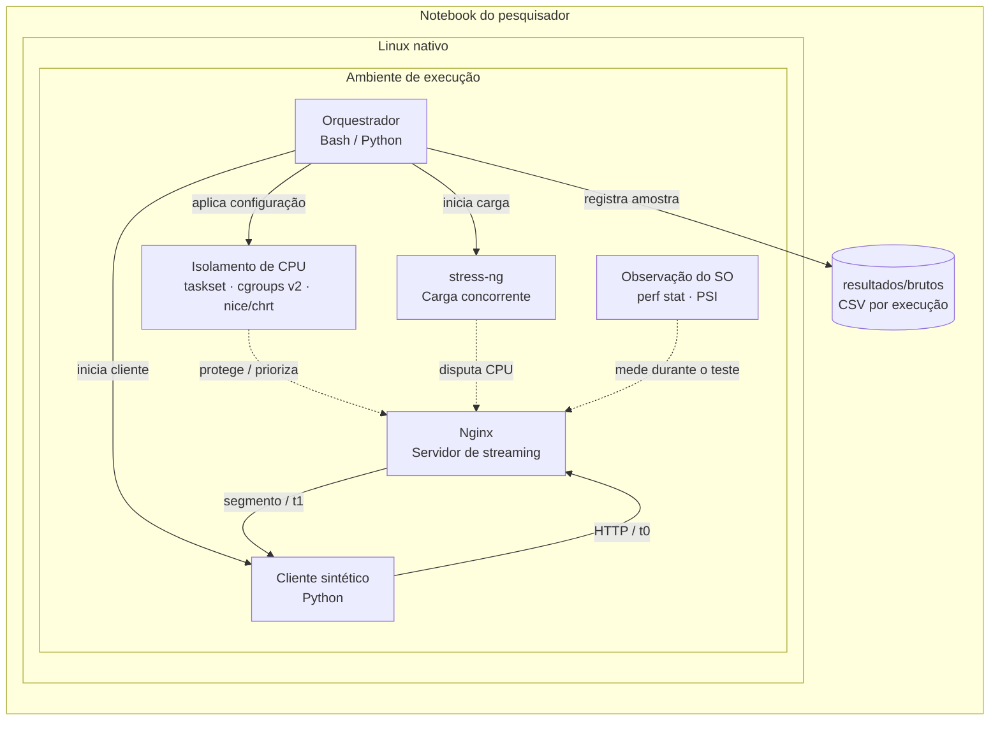
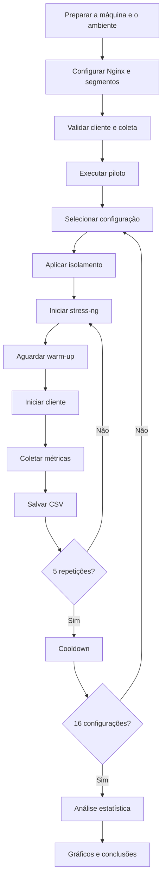

# Streaming sob Contenção de Recursos (Linux, Nginx)

## Disciplina

**Sistemas Operacionais — IFPB**

## Objetivo e escopo

Este projeto investiga o impacto da contenção de CPU no desempenho de um servidor de streaming de vídeo e avalia se mecanismos de isolamento de CPU do Linux conseguem reduzir essa degradação.

O experimento será executado em uma máquina física com Linux nativo (sem máquina virtual). O servidor de streaming será o Nginx, com segmentos de vídeo pré-gerados. Um cliente sintético solicitará os segmentos continuamente enquanto processos concorrentes gerados pelo `stress-ng` disputam CPU com o servidor.

Os resultados representam **esta plataforma experimental local** e não um provedor real de streaming em nuvem.

### Perguntas de pesquisa

1. Como o aumento do número de processos concorrentes afeta o throughput, a latência de resposta e a taxa de rebuffering?
2. Mecanismos de isolamento de CPU reduzem essa degradação? Qual apresenta melhor resultado?
3. O efeito observado nas métricas do sistema operacional acompanha o efeito observado nas métricas de desempenho do streaming?

---

# 1. Arquitetura do ambiente experimental



### Funcionamento

- O **Nginx** disponibiliza segmentos de vídeo pré-gerados.
- O **cliente sintético** solicita os segmentos em sequência, simulando uma reprodução contínua.
- O **stress-ng** gera processos concorrentes que disputam CPU com o servidor.
- O **orquestrador** seleciona a configuração, aplica o isolamento, inicia a carga, executa o cliente e registra os resultados.
- As ferramentas de observação coletam informações do sistema operacional durante o experimento.

---

# 2. Hardware e software

## Hardware

| Item | Especificação |
|---|---|
| Equipamento | Notebook do pesquisador |
| CPU do host | 6 núcleos / 12 threads |
| Memória do host | 8 GB |
| Armazenamento | ~239 GB |
| Ambiente | Linux nativo (sem VM) |
| Sistema operacional | A registrar (Ubuntu, kernel 7.0.0-43-generic) |
| CPUs lógicas (N) | 12 |

## Software

| Software | Utilização |
|---|---|
| Nginx | Servidor de streaming |
| stress-ng | Geração de contenção de CPU |
| taskset / sched_setaffinity | Afinidade de CPU |
| cgroups v2 (v1 no piloto) | Limitação/garantia de CPU; o orquestrador detecta a versão |
| nice / chrt | Prioridade de processos |
| Cliente Python (`workloads/cliente_streaming.py`) | Requisições HTTP, latência e rebuffering (usado no piloto) |
| ab / wrk | Previstos para a coleta definitiva (throughput máximo, cliente em C) |
| /proc/PID/status | Context switches do worker do Nginx (usado no piloto) |
| perf stat | Opcional; não funcionou no container do piloto |
| /proc/pressure/cpu | PSI de CPU |
| Python / Bash | Cliente, orquestração e coleta |
| Pandas / SciPy / Matplotlib | Análise e visualização |

Antes da coleta definitiva, serão registradas em `docs/ambiente.md` as versões do kernel, Nginx e demais componentes relevantes.

---

# 3. Fatores e configurações comparados

O experimento combina dois fatores:

| Fator | Níveis |
|---|---|
| **Modo de isolamento** | Sem isolamento; CPU affinity; cgroups; prioridade elevada |
| **Nível de contenção** | 0; 2; 4; 8 processos concorrentes |
| **Condições fixas** | Mesmo conteúdo e mesma taxa de solicitação |

### Total

**4 modos × 4 níveis de contenção = 16 configurações**

| Configuração | Isolamento | Contenção |
|---|---|---:|
| C01 | Sem isolamento | 0 |
| C02 | Sem isolamento | 2 |
| C03 | Sem isolamento | 4 |
| C04 | Sem isolamento | 8 |
| C05 | CPU affinity | 0 |
| C06 | CPU affinity | 2 |
| C07 | CPU affinity | 4 |
| C08 | CPU affinity | 8 |
| C09 | cgroups | 0 |
| C10 | cgroups | 2 |
| C11 | cgroups | 4 |
| C12 | cgroups | 8 |
| C13 | Prioridade | 0 |
| C14 | Prioridade | 2 |
| C15 | Prioridade | 4 |
| C16 | Prioridade | 8 |

---

# 4. Workloads

| ID | Componente | Função |
|---|---|---|
| W1 | Cliente de streaming | Solicita segmentos de vídeo em sequência ao Nginx |
| W2 | stress-ng | Gera processos concorrentes que disputam CPU |

O conteúdo e a taxa de solicitação devem permanecer constantes entre as configurações.

---

# 5. Métricas

A métrica central é a degradação provocada pela contenção e o quanto cada mecanismo de isolamento consegue recuperar o desempenho.

| Métrica | Definição | Coleta |
|---|---|---|
| Throughput | Segmentos ou Mbps entregues por segundo | Cliente Python (`ab` / `wrk` na definitiva) |
| Latência | Tempo entre requisição e recebimento do segmento | Cliente Python |
| P95 / P99 | Percentis de cauda da latência | Cliente Python |
| Rebuffering | Segmentos que não chegam a tempo de manter a reprodução | Cliente Python |
| Uso de CPU | CPU utilizada pelo Nginx | `/proc/PID/stat` (cgroups) |
| Context switches | Trocas de contexto | `/proc/PID/status` (`perf stat` opcional) |
| PSI de CPU | Pressão causada pela indisponibilidade de CPU | `/proc/pressure/cpu` |

Para as métricas numéricas serão consideradas, quando aplicável: média, mediana, desvio padrão, p95 e p99.

---

# 6. Ferramentas de medição

- `ab` ou `wrk` — geração de requisições HTTP.
- Cliente próprio em Python — simulação do streaming e cálculo de rebuffering.
- `stress-ng` — geração de contenção.
- `taskset` — afinidade de CPU.
- cgroups v2 — controle de CPU.
- `nice` / `chrt` — prioridade.
- `perf stat` — observação de desempenho e context switches.
- `/proc/pressure/cpu` — PSI.
- Bash/Python — automação e consolidação dos resultados.

---

# 7. Quantidade de repetições

| Item | Quantidade |
|---|---:|
| Piloto | 3 execuções por configuração (48 execuções; ver `docs/relatorio_piloto.md`) |
| Coleta definitiva | 5 execuções por configuração |
| Configurações | 16 |
| Execuções definitivas | **80** |
| Duração de cada execução | Ex.: 60 segundos |

As execuções são feitas em ordem sorteada (e não em blocos de 5 repetições por configuração). Entre execuções será utilizado um período de **cooldown** para encerrar processos e reduzir interferências entre amostras.

---

# 8. Procedimento experimental



### Etapas

1. Preparar a máquina Linux.
2. Configurar o Nginx e os segmentos de vídeo.
3. Validar o cliente sintético.
4. Registrar o ambiente em `docs/ambiente.md`.
5. Executar o piloto.
6. Para cada configuração, aplicar o mecanismo de isolamento.
7. Iniciar o `stress-ng`.
8. Aguardar o warm-up.
9. Iniciar o cliente.
10. Coletar as métricas durante o período definido.
11. Salvar a execução em um novo CSV.
12. Repetir cinco vezes.
13. Executar cooldown.
14. Passar para a próxima configuração.
15. Ao final, analisar os dados e gerar os gráficos.

---

# Registro dos resultados

Os resultados brutos ficam em `resultados/brutos/`. Cada **rodada** gera um CSV novo (uma linha por execução), nunca sobrescrito, com um `_meta.json` (semente, argumentos, kernel) e a latência de cada requisição em `amostras/`. A ordem das execuções é sorteada (semente registrada) para que o horário não se confunda com o efeito dos fatores.

```text
resultados/brutos/
├── rodada1_2026-10-16.csv
├── rodada1_2026-10-16_meta.json
└── amostras/
    └── <run_id>.csv.gz
```

Colunas do CSV:

| Coluna | Conteúdo |
|---|---|
| rodada, run_id, ordem | Identificação e posição no sorteio |
| modo, nivel_contencao, rep | Configuração (C01–C16 = modo × nível) e repetição |
| inicio_iso, duracao_s | Data/hora e duração da medição |
| n_req, n_falhas | Requisições feitas e falhas |
| thr_req_s, thr_MBps | Throughput |
| lat_media_ms, lat_mediana_ms, lat_p95_ms, lat_p99_ms, lat_max_ms | Latência |
| reb_20ms, reb_50ms, reb_100ms | Fração de segmentos acima do limiar (proxy de rebuffering) |
| cpu_servidor_pct, cpu_host_pct, loadavg1 | Uso de CPU |
| ctx_vol, ctx_invol | Context switches do servidor |
| psi_some_us_por_s | PSI de CPU |
| descartada, obs | Se a execução foi descartada e por quê |

---

# Limitações e ameaças à validade

- **Plataforma local:** os resultados representam a máquina Linux utilizada no experimento.
- **Recursos limitados:** a máquina possui 8 GB de RAM e 12 CPUs lógicas.
- **Carga sintética:** `stress-ng` não representa perfeitamente uma aplicação real.
- **Cliente sintético:** o comportamento é simplificado e não reproduz toda a dinâmica de clientes reais.
- **Hardware único:** os resultados valem para essa máquina; outras podem saturar em níveis diferentes.
- **Streaming simplificado:** o experimento não pretende reproduzir integralmente um serviço comercial de streaming.

As principais medidas de mitigação são manter o conteúdo, a configuração do cliente e o procedimento constantes, monitorar memória/swap e registrar o ambiente antes das coletas.

---

---

# Estrutura do repositório

```text
.
├── README.md
├── executar_piloto.sh          # roda o piloto de ponta a ponta
├── docs/
│   ├── ambiente.md
│   └── relatorio_piloto.md     # resultados e problemas do piloto
├── orquestrador/
│   ├── README.md
│   └── run_experimento.py
├── workloads/
│   ├── README.md
│   ├── cliente_streaming.py
│   └── gerar_segmentos.sh
├── configs/
│   ├── README.md
│   └── nginx.conf.tpl
├── resultados/
│   ├── README.md
│   └── brutos/                 # CSVs, _meta.json e amostras/
├── analise/
│   ├── README.md
│   ├── analisar.py
│   └── saida/                  # resumo e gráficos
└── latex/
    ├── README.md
    └── artigo.tex
```

| Pasta | Conteúdo |
|---|---|
| `docs/` | Registro do ambiente e relatório do piloto |
| `orquestrador/` | Script que automatiza os experimentos |
| `workloads/` | Cliente sintético e gerador de segmentos |
| `configs/` | Modelo de configuração do Nginx |
| `resultados/` | Dados brutos coletados |
| `analise/` | Estatística e gráficos |
| `latex/` | Documentação final do projeto |

---

# Referências

- Documentação do Linux sobre cgroups v2: https://docs.kernel.org/admin-guide/cgroup-v2.html
- Documentação do Linux sobre PSI: https://docs.kernel.org/accounting/psi.html
- stress-ng: https://github.com/ColinIanKing/stress-ng


## Mitigação adaptativa (modo `adaptativo`)

5º modo do orquestrador: `orquestrador/controlador.py` mede a espera do worker do Nginx na fila de execução
(`/proc/PID/schedstat`) a cada 200 ms e, se ela passar do limiar por 2 janelas seguidas, aperta o teto de CPU
(`cpu.max`/`cpu.shares`) do grupo do `stress-ng` e aumenta o peso do servidor; relaxa quando a espera cai.
`workloads/fila_cpu.bt` mede a mesma espera com eBPF (bpftrace; opcional, `--ebpf`).
Calibração dos limiares: `--ctl-observar` + `analise/resumo_controlador.py`. Níveis padrão: 0, N/2, N, 2N. `--cpus K` confina Nginx, cliente e carga às CPUs 0..K-1 (N passa a valer K).
